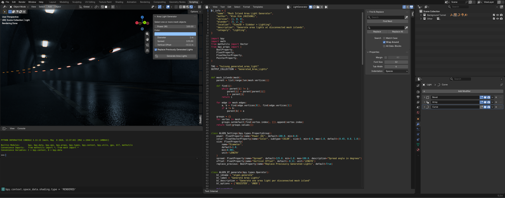
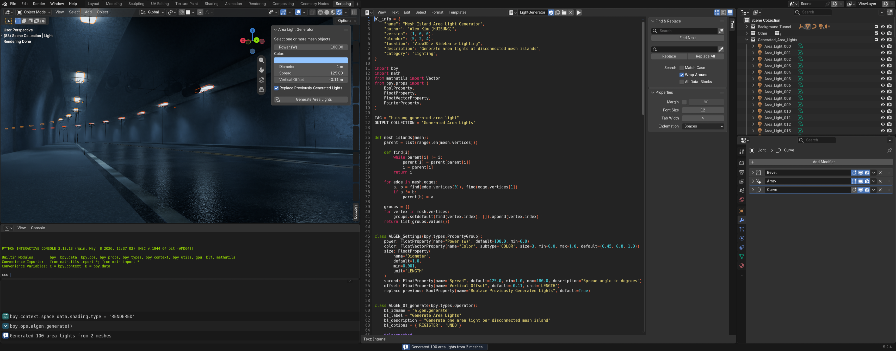
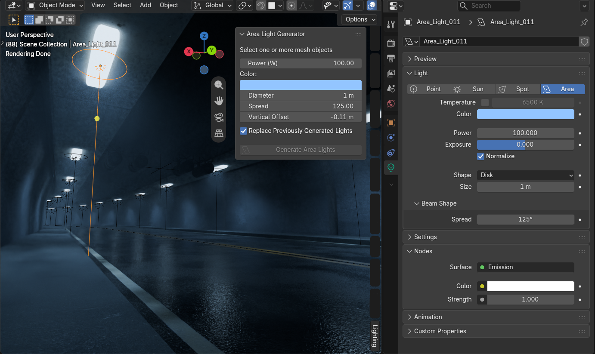

# **Blender Area Light Generator**

A Blender tool for automated area light placement in 3D environments. Originally developed for a personal cinematic project to automate repetitive lighting tasks in curved tunnel environment.

## Overview

This tool analyzes selected mesh objects, identifies disconnected mesh components, and automatically generates disk-shaped area lights at the center of each component.

It supports evaluated mesh geometry, allowing light placement on objects modified with Array and Curve modifiers without applying them.

## Features

* **Automatic Light Placement:** Generates one disk-shaped area light per disconnected mesh island.
* **Modifier Support:** Works with evaluated mesh geometry, including Array and Curve modifiers.
* **Customizable Settings:** Adjust light power, color, diameter, spread, and vertical offset.
* **Blender UI Integration:** Provides an N-panel interface for configuring and generating lights.
* **Safe Regeneration:** Replaces previously generated lights while preserving unrelated scene objects.
* **Multiple Object Support:** Processes one or more selected mesh objects.

## Technical Implementation

The script uses Blender's Python API (bpy) to access evaluated mesh geometry through the dependency graph.

A Union-Find (Disjoint Set Union) algorithm identifies disconnected mesh components by grouping vertices based on edge connectivity.

For each component, the tool calculates the average vertex position, transforms it into world coordinates, and generates an area light at the resulting location.

Generated lights are organized into a dedicated collection and tagged with custom properties.

This allows the tool to replace previously generated lights without affecting unrelated objects.

## Requirements

* Blender 5.2.4 (Compatibility with earlier Blender versions has not been verified)
* Python scripting support through Blender

## Installation

1. Download light\_generator.py
2. Open a Blender project and switch to the Scripting workspace.
3. Open the Python file in Blender's Text Editor.
4. Click Run Script.
5. Open the 3D Viewport and select the Lighting tab to access the Area Light Generator Panel. (press N if it is hidden)

## Usage

1. Select one or more mesh objects containing the geometry where lights should be placed.
2. Open the Area Light Generator in the N-panel.
3. Adjust the light settings as needed.
4. Enable Replace Previously Generated Lights to regenerate lights without accumulating duplicates.
5. Click Generate Area Lights.

Generated lights will appear in the Generated\_Area\_Lights collection.

## Preview

### Before Generation

Scene containing emission meshes arranged along a curved tunnel using Array and Curve modifiers.

### After Generation

Disk-shaped area lights automatically generated at the center of each disconnected mesh component.

### Light Settings Verification

Generated area light selected to demonstrate that the configured parameters are correctly applied to Blender's light properties.

## Development Notes

This tool was developed with AI-assisted coding to address repetitive lighting tasks encountered during personal 3D cinematic production.

The workflow requirements were based on practical production needs, with iterative testing and refinement performed in Blender.

## Author

Alex Kim (HUISUNG)

